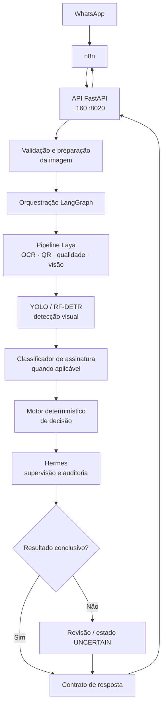
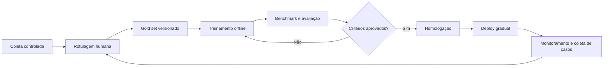

# LAYA_CYPRESS

Plataforma de processamento e validação de documentos do fluxo hortifruti, integrada ao WhatsApp por meio do n8n. Recebe imagens de documentos, executa extração e análise visual, aplica regras de negócio e devolve ao n8n o contrato compatível com a integração existente:

```json
{
  "output": "<json>",
  "_meta": {}
}
```

O projeto evolui para uma arquitetura composta por **serviços de visão computacional, motor determinístico de decisão, orquestração com LangGraph e supervisão do Hermes**. O contrato consumido pelo n8n deve permanecer compatível durante essa evolução.

> **LGPD:** o repositório é privado. Imagens e documentos reais de clientes não devem ser versionados no Git. Dados de produção só podem ser utilizados em treinamento após os controles de acesso, retenção, rotulagem e governança definidos pelo projeto.

## Arquitetura

### Visão geral



O diagrama representa a **arquitetura-alvo**. Componentes identificados como sombra, opcionais ou em evolução não devem ser considerados parte do caminho crítico de produção até que sua integração seja implementada e validada.

### Responsabilidades

| Componente | Responsabilidade |
|---|---|
| **n8n** | Receber eventos do WhatsApp, encaminhar imagens ao serviço e consumir o contrato de resposta. |
| **FastAPI** | Expor a API, validar requisições, coordenar a execução do serviço e preservar o contrato de integração. |
| **Laya** | Executar a análise primária do documento: qualidade da imagem, OCR, QR Code, evidências visuais e extração de campos. |
| **PyTorch** | Base de desenvolvimento, treinamento, avaliação e inferência dos modelos de visão computacional. |
| **YOLO / RF-DETR** | Detectar e localizar regiões ou evidências visuais relevantes no documento. A utilização em produção depende de benchmark e validação. |
| **Classificador de assinatura** | Classificar recortes/regiões relevantes quando necessário, complementando a detecção. |
| **Motor de decisão** | Aplicar regras determinísticas, thresholds calibrados e critérios de encaminhamento. |
| **LangGraph** | Orquestrar etapas, estado, roteamento, tratamento de falhas e pontos de revisão do fluxo Laya/Hermes. Não substitui os modelos de visão nem a API. |
| **Hermes** | Supervisionar a execução do Laya, auditar evidências e regras, identificar inconsistências e encaminhar casos inconclusivos. Não deve apenas repetir ou aceitar automaticamente a previsão do Laya. |
| **EvalKit / Gold set** | Manter a referência rotulada e medir regressões e desempenho antes de promover mudanças. |

### Estados de resultado

A classificação de assinatura deve distinguir ausência de assinatura de situações em que não há evidência suficiente para decidir:

- `SIGNED`: evidência visual de assinatura identificada.
- `UNSIGNED`: ausência de assinatura confirmada em imagem adequada e observável.
- `UNCERTAIN`: evidência ambígua ou confiança insuficiente; requer tratamento adicional ou revisão.
- `INVALID_IMAGE`: imagem inválida, ilegível, cortada ou inadequada para análise.

A detecção visual de uma assinatura não autentica o signatário nem comprova, isoladamente, validade jurídica do documento.

### Regras de evolução

- Não treinar modelos continuamente com previsões geradas em produção.
- Não tratar a concordância entre Laya e Hermes como ground truth.
- Utilizar rótulos confirmados, conjunto de avaliação independente e benchmark reproduzível.
- Promover modelos somente após avaliação, aprovação e possibilidade de rollback.
- Manter o motor de decisão separado dos modelos e do LLM.
- Persistir resultados e metadados operacionais; armazenar imagens em repositório apropriado, não no Git.
- Preservar compatibilidade do contrato `output` / `_meta` com o n8n.

## Mapa do repositório

| Pasta | Responsabilidade |
|---|---|
| `service/app/` | Serviço FastAPI. Recebe documentos, executa o pipeline de processamento e monta o contrato de resposta consumido pelo n8n. |
| `detector/` | Detector de assinatura em modo sombra (RF-DETR + linha de corte), executado no `.140`. Consulte [detector/LEIA-ME.md](detector/LEIA-ME.md). |
| `evalkit/` | Gold set e avaliação: `python -m evalkit add/validate/score`. |
| `scripts/coleta/` | Coleta de canhotos a partir de Power BI e Bubble (`foto_canhoto`), cliente read-only do MCP do Bubble e dicas por nome de arquivo. |
| `scripts/rotulagem/` | Ferramentas de rotulagem (rotulador em `127.0.0.1:8742`), importação da triagem e ordenação de candidatos. |
| `scripts/ocr/` | Empacotamento de imagens e extração de OCR + tinta no container do `.160`. |
| `scripts/treino/` | Conversão de rótulos e dados de OCR para linhas tipadas do ITS-FINE. |
| `scripts/benchmark/` | Benchmark contra o serviço, painel em `127.0.0.1:8743` e smoke tests. |
| `tests/` | Testes automatizados. Execute `python -m pytest -q`. |
| `gold/` | Gold set (fora do Git, exceto `manifest.jsonl`): `images/`, `ocr/`, `origem/`, `triagem/`, `backups/` e `predictions/`. |
| `assets/` | Manifestos de origem dos canhotos e documentação das fontes. |
| `n8n/` | Fluxos de integração do WhatsApp e configurações auxiliares. Arquivos com credenciais permanecem fora do Git. |
| `SPEC/` | Contratos de saída por tipo de documento. |
| `docs/` | Documentação de arquitetura, operação, dataset e avaliação. Consulte [docs/README.md](docs/README.md). |
| `.its-fine/`, `_itsfine_runs/` | Framework de fine-tuning e registros de suas execuções. Não editar manualmente. |
| `_lixeira/` | Quarentena de limpeza; conferir antes de remover. |

> A presença de uma pasta ou ferramenta no repositório não significa que ela já esteja integrada ao fluxo crítico de produção. Consulte os documentos específicos e o estado de implantação antes de assumir disponibilidade.

## Infraestrutura

### Hosts e serviços conhecidos

| Host | Serviço | Porta / caminho | Papel |
|---|---|---|---|
| `192.168.0.160` | FastAPI | `8020` — `/opt/laya-cypress` | API de entrada e serviço de processamento documental em Docker. |
| `192.168.0.160` | n8n | Conforme configuração local | Integração com WhatsApp e consumo do contrato do Laya. |
| `192.168.0.160` | MCP do Bubble | `8787` | Acesso de integração ao Bubble. |
| `192.168.0.140` | Laya | `8010` | Serviço/modelo de IA utilizado no ambiente atual. |
| `192.168.0.140` | vLLM / Qwen | `8001` | Servidor de inferência do modelo Qwen. |
| `192.168.0.140` | Detector de assinatura | `8030` | Execução em modo sombra para avaliação do detector. |

**Nota de arquitetura:** LangGraph é a camada planejada de orquestração do fluxo entre análise, decisão, supervisão e revisão. Sua adoção não altera, por si só, os endereços e contratos dos serviços acima. A implantação efetiva deve ser registrada quando concluída.

## Fluxo de processamento esperado

1. O n8n recebe a imagem pelo fluxo do WhatsApp e envia a requisição ao FastAPI.
2. O serviço valida a entrada e prepara a imagem para análise.
3. O Laya executa a análise documental primária, incluindo OCR, leitura de QR quando aplicável, qualidade da imagem e extração de campos.
4. Os componentes de visão localizam e classificam evidências relevantes, incluindo assinatura, conforme a configuração validada.
5. O motor determinístico aplica as regras de negócio e define o resultado ou encaminhamento.
6. O Hermes supervisiona a análise, verifica inconsistências e solicita revisão quando não há evidência suficiente.
7. O serviço serializa o resultado no contrato `{"output": "<json>", "_meta": {...}}` e o devolve ao n8n.

## Treinamento, avaliação e dados

O treinamento deve ocorrer fora do caminho de produção. O ciclo recomendado é:



- `gold/` mantém os dados de referência conforme as regras de privacidade do projeto.
- Rótulos confirmados são a fonte de verdade para avaliação e treinamento.
- Predições automáticas podem ajudar a priorizar a triagem, mas não substituem a confirmação humana.
- Métricas devem ser analisadas por classe e por tipo de documento; acompanhar especialmente falsos `UNSIGNED`, falsos `SIGNED` e taxa de `UNCERTAIN`.
- Mudanças de modelo devem ser comparadas com uma versão de referência antes da promoção.

## Execução e testes

```bash
# Testes automatizados
python -m pytest -q

# Operações do EvalKit
python -m evalkit add
python -m evalkit validate
python -m evalkit score
```

Consulte a documentação de cada módulo para os argumentos e configurações específicos.

## Segurança e LGPD

- Não versionar imagens, documentos reais, dumps, credenciais, tokens ou arquivos de configuração sensíveis.
- Manter segredos em mecanismo apropriado de configuração/segredos, fora do código e do Git.
- Restringir acesso aos documentos por necessidade operacional e registrar acessos relevantes.
- Definir retenção e descarte para imagens, OCR, recortes, logs e backups.
- Evitar conteúdo documental sensível em logs; utilizar IDs de correlação e metadados mínimos.
- Antes de enviar dados a qualquer serviço externo, validar base legal, contrato, localização do processamento e política de retenção.
- Garantir que os diretórios locais de dados e artefatos estejam cobertos pelo `.gitignore`.

## Documentação relacionada

- [Documentação e índice](docs/README.md)
- [Documentação do detector](detector/LEIA-ME.md)
- [Contratos por tipo de documento](SPEC/)

