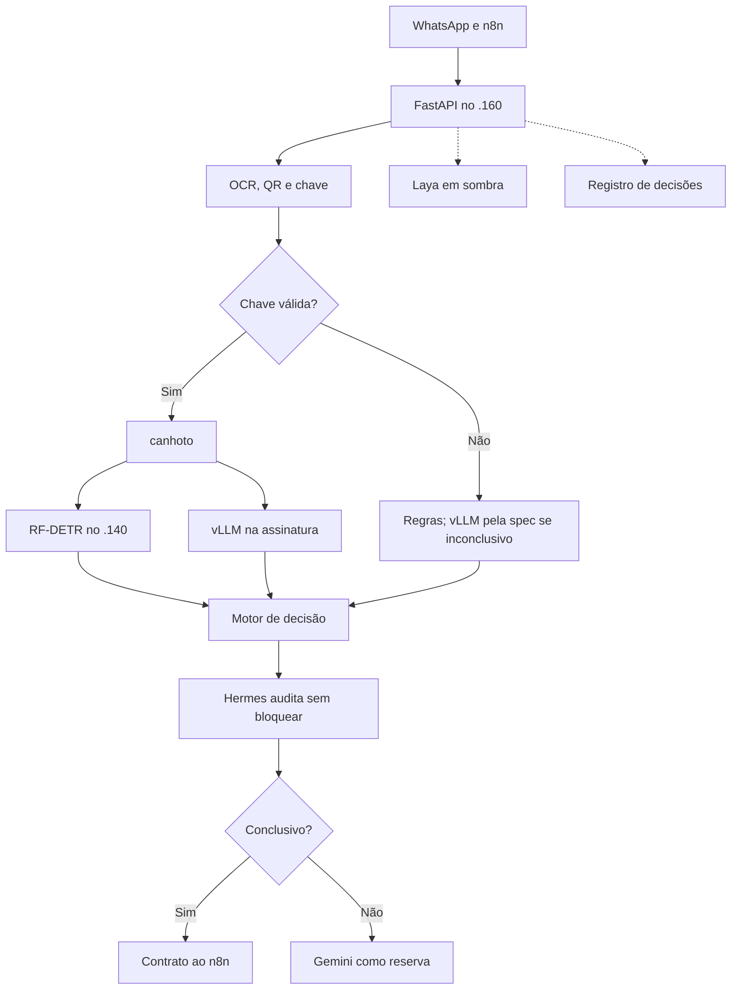
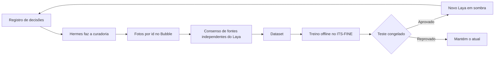

# Estrutura do protótipo sem o Gemini como provedor principal — 2026-11-05

Proposta aguardando decisão sobre o teto do vLLM. Nada abaixo foi implementado, salvo onde indicado.

## Fluxo de produção

## Regra de liberação da assinatura

| RF-DETR | vLLM | Estado | Confiança | Passa no If4 |
|---|---|---|---|---|
| Assinado | Assinado | `SIGNED` | 95 | Sim |
| Sem assinatura | Sem assinatura | `UNSIGNED` | a do vLLM, até 89 | Não |
| Discordam | Discordam | `UNCERTAIN` | 0 | Não |
| Falha em qualquer um | | `UNCERTAIN` | 0 | Não |

## Trilha de treino, fora da produção

- O Hermes seleciona e audita. Quem treina é o ITS-FINE.
- Sem o Gemini como principal, uma amostra de 10% segue indo a ele como referência independente.
- O Laya só passa a decidir o tipo se vencer as regras no teste congelado.

## Fases

| Fase | O que acontece | Avança quando |
|---|---|---|
| 0. Sombra | Protótipo completo, sem responder ao cliente | 300 pares: nenhum sem assinatura liberado, 80% dos assinados liberados, até 1% de tipo grave, p95 abaixo de 25 s |
| 1. Piloto | 10% dos telefones | Sem liberação indevida, reserva e reenvios estáveis |
| 2. Principal | 100%, com Gemini como reserva e amostra de 10% | Reserva abaixo de 15% |
| 3. Treino | 3 meses de ciclos do Laya em sombra | Laya vence as regras no teste congelado |

## Conflito em aberto
Assinatura com vLLM em todo canhoto não cabe no teto de 20%: canhotos são a maioria das fotos.
