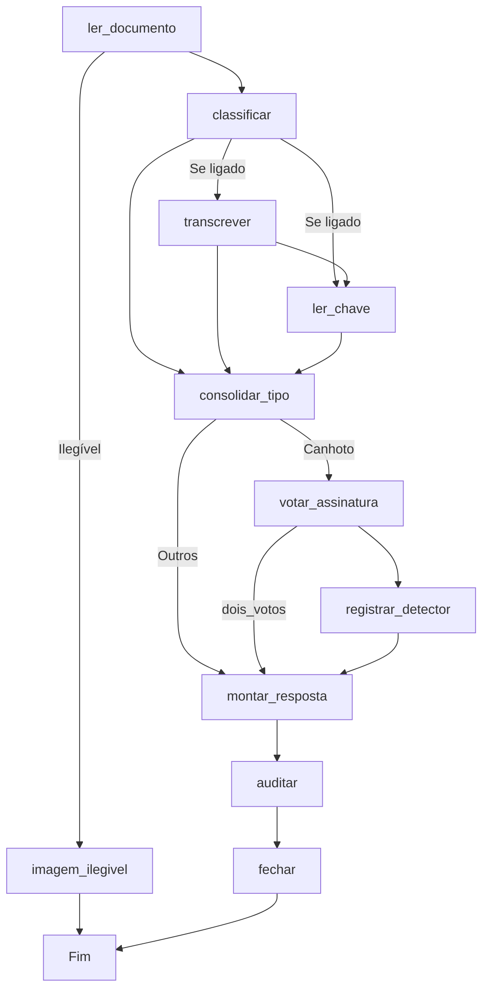

# Continuidade do protótipo: onde paramos — 2026-11-05

Comece por este arquivo. O histórico completo e as medições estão em `2026-11-05.md`.

## Situação em uma frase
A orquestração em LangGraph está escrita e revisada por leitura, mas nunca foi executada. **O próximo passo é rodar os testes no Windows e, se passarem, publicar no .160.**

## Objetivo do protótipo
Serviço de extração de documentos do fluxo WhatsApp → n8n (canhoto, comprovante, pedido, imagem inválida), no lugar do Gemini (`AI Agent1`).

Saída-alvo, a de `ajustar_resposta`: `tipo_documento`, `assinatura{possui_assinatura, confianca, descricao}`, `emitente.cnpj`, `nota_fiscal.numero`, `qrcode.chave`.

## Decisões em vigor
- **Serviço como fluxo principal.** O Gemini é reserva se o serviço cair, ficar fora do ar ou ficar em dúvida (`_meta.inconclusivo`). Não há divisão 50%/80% nem piloto por telefone.
- **Assinatura só com o vLLM por enquanto** (`SIGNATURE_ENGINE=juiz`), enquanto YOLOv8 + RF-DETR são treinados. O detector atual só registra.
- **Tipo do documento por regras e chave de acesso** (`TYPE_ENGINE=regras`). O Laya fica em sombra e o Hermes só registra auditoria.
- **Sem rotulagem humana.** Rótulos vêm do consenso de fontes independentes do modelo treinado, com teste congelado e auditoria.
- **YOLOv8 escolhido** sabendo que a Ultralytics declara AGPL-3.0 ou licença Enterprise, inclusive para uso interno. A licença precisa ser definida antes da produção.
- **LangGraph sem checkpointer e sem rastreamento externo**, porque o estado do grafo contém a foto do cliente.
- `possui_assinatura:false, confianca:0` significa "não consegui confirmar", não "sem assinatura". Esse caso vai para a reserva.

## O que está em produção no .160 (informado pelo usuário)
- Deploy com `SIGNATURE_ENGINE=juiz`, `JUDGE_TRANSCRIBE=0`, status `healthy`, 306 testes passando **antes** da migração.
- Também valem `TYPE_ENGINE=regras`, `HERMES_AUDIT=1` e `DECISION_DIGEST_KEY` ligada. `JUDGE_READ_KEY` está desligada.
- **LangGraph ainda não está no .160.**

## O que mudou e não foi executado
| Arquivo em `service/app/` | Papel |
|---|---|
| `document_graph.py` | Estado, etapas e rotas do grafo |
| `type_steps.py` | Decisão do tipo do documento |
| `signature_steps.py` | Decisão da assinatura conforme o motor configurado |
| `engines.py` | Dependências do documento, prazo e capacidade do vLLM |
| `fields.py` | `extract_fields` e `laya_signals` |
| `pipeline.py` | Fachada: `Pipeline.run` e reexportações; contrato sem mudança |

- Teste novo: `tests/test_document_graph.py` (7 testes).
- A revisão por leitura não achou erro de lógica nem de import. Isso não substitui a execução.
- Última correção: o rastreamento é desligado antes do import do LangGraph, nas quatro variáveis. Não foi confirmado na biblioteca instalada se as quatro são necessárias.

### Grafo


## Próximos passos, em ordem

### 1. Testar no Windows
```powershell
python -m pip install "langgraph>=1,<2"
python -m pytest tests -q
```
Precisa dar zero falhas. A expectativa é de cerca de 313 testes (306 + 7), mas esse total é uma estimativa. Se algo falhar, não publique.

### 2. Enviar e comparar
No Windows:
```powershell
tar --exclude=__pycache__ -czf laya-service.tgz service
scp laya-service.tgz vm-debian-service@192.168.0.160:/tmp/
scp _itsfine_runs/laya-continuo-r5/medir_perdas_sombra.py vm-debian-service@192.168.0.160:/tmp/
```

No .160:
```bash
cd /opt/laya-cypress
rm -rf /tmp/laya-novo && mkdir -p /tmp/laya-novo
tar xzf /tmp/laya-service.tgz -C /tmp/laya-novo
diff -rq service /tmp/laya-novo/service
```
Esperado: `pipeline.py` diferente; novos `document_graph.py`, `engines.py`, `fields.py`, `signature_steps.py` e `type_steps.py`; além do `image_io.py.bak`. Se aparecer outra diferença, analise antes de aplicar.

### 3. Aplicar no .160
```bash
tar czf service.bak.20261105-langgraph.tgz service
cp requirements.txt requirements.txt.bak.langgraph
docker tag laya-cypress:local laya-cypress:antes-langgraph
cp -r /tmp/laya-novo/service/. service/
grep -q '^langgraph' requirements.txt || echo 'langgraph>=1,<2' >> requirements.txt
docker compose build laya-cypress && docker compose up -d laya-cypress
sleep 25
docker ps --format '{{.Names}}\t{{.Status}}' | grep laya-cypress
docker exec laya-cypress python -c 'import langgraph, importlib.metadata as m; from service.app.main import create_app; print("langgraph", m.version("langgraph"))'
docker exec laya-cypress printenv SIGNATURE_ENGINE JUDGE_TRANSCRIBE
```
Esperado: `(healthy)`, a versão do `langgraph`, `juiz` e `0`.

Para reverter:
```bash
cd /opt/laya-cypress
rm -rf service && tar xzf service.bak.20261105-langgraph.tgz
cp requirements.txt.bak.langgraph requirements.txt
docker tag laya-cypress:antes-langgraph laya-cypress:local
docker compose up -d --force-recreate laya-cypress
```

### 4. Validar com foto real
Envie um canhoto legível pelo fluxo e rode:
```bash
SINCE=$(docker inspect -f '{{.State.StartedAt}}' laya-cypress | cut -c1-19)
docker exec -i laya-cypress python - /srv/dados/decisoes.jsonl "$SINCE" < /tmp/medir_perdas_sombra.py
```
`ALARME_liberados_contra_gemini` precisa dar 0. Esse número também mede a cobertura real do motor `juiz`, estimada em até cerca de 77%, sem medição.

## Pendências

### Urgentes
- **IF de `inconclusivo` no n8n:** confirmar que ele vem antes do `ajustar_resposta`. Sem isso, "não consegui confirmar" pode seguir como "sem assinatura". Especificação em `2026-11-05-n8n-roteamento.md`.
- **Divergência de chave em `MOHPMSRQ781T`:** saiu `SIGNED`, sem reserva, e não se sabe qual leitura está certa. Comparar as chaves e ver a foto.
- **Credenciais expostas:** o fluxo do n8n foi colado com tokens em texto claro. Trocar todos e mover para o cofre do n8n. A troca não foi confirmada.

### Para fechar o protótipo
- Aplicar o README: texto em `2026-11-05-readme-proposto.md`, com as features futuras. O agente não consegue gravar no `README.md`. Ao aplicar, decidir sobre a troca das regras de confirmação humana.
- Rodar `medir_chave_vllm.py`. Só ligar `JUDGE_READ_KEY=1` se `com_codigo.valida_diferente` der 0. Precisa de `/tmp/gold` no .160.
- Criar o Git privado, incluindo `compose.yaml`, `Dockerfile` e `requirements.txt`, que hoje só existem no .160.
- Comparar `7RSDD83DOJRI` (confirmar se é o caso dos 47 dígitos) e `80UUGQ4RHD1S`.
- Verificar quem usa `qrcode.chave` depois do fluxo e validar tamanho e dígito da chave do Gemini no n8n.
- Amostra de cerca de 10% para o Gemini no n8n e `onError` no nó `sombra_laya_cypress`.

### Treino do detector (feature futura)
- Rodar `medir_yolov8.py` no Windows: venv `$HOME\.venvs\laya-yolo`, aceitar os termos no Hugging Face e trazer `limiar.jsonl` por `scp`.
- Decidir o teste de 50 fotos com caixas confirmadas pelo vLLM e onde treinar (GPU do .140 ou Colab).
- Pesos: `tech4humans/yolov8s-signature-detector` (acesso restrito; fontes divergem sobre a licença). Dataset: `tech4humans/signature-detection`.

### Limpeza
- Remover `/tmp/gold`, `/tmp/gold.tgz` e `gold.tgz` no Windows, depois das medições.
- Remover `/root/.env` e `image_io.py.bak` no .160, depois de conferi-los.
- Conferir `SPEC/comprovante_contract.json` e `_lixeira/2026-10-30`.
- Criar o script de curadoria e apertar a regra de `pedido`.

## Números que sustentam as decisões
- **Leitura (gold dev):** assinados prontos para os votos subiram de 78 para 107 de 119 e de 88 para 106 de 118, com o código reforçado.
- **Votos (100 assinados e 8 sem assinatura):** 72 liberados, 0 sem assinatura liberados. O vLLM aprovou 72 dos 75 que o detector aprovou. Mediana de 3,48 s, p95 de 7,08 s.
- **Detector em todo o dev:** limiar 0,31 mantido. Dá 287 de 431 prontos e 0 de 8 sem assinatura. Em 0,05 passam 412, mas também 6 de 8.
- **Fotos reais com `dois_votos` (85 que o Gemini leu como canhoto assinado):** 49 liberadas (57,6%). O detector não viu 17 e a leitura perdeu 17.

**Risco principal:** com `juiz`, a segurança depende de um único filtro, e há apenas 8 canhotos sem assinatura para medi-lo. Liberar um canhoto sem assinatura tem impacto alto, segundo o usuário.

## Regras de trabalho
- **O usuário executa os comandos.** O hook bloqueia o shell do agente e buscas amplas na raiz do projeto (`PRIVATE_DATA_SHELL_DENIED`, `SEARCH_INCLUDES_PRIVATE_DATA`). Não contornar.
- `.its-fine/policy.json` é só do usuário: permissões mudam por `python .its-fine/bin/fine.py permissoes`.
- Não ler `.env`, `*.jsonl` nem o conteúdo de `_itsfine_runs/`; pedir apenas agregados.
- Nenhuma chave de acesso, credencial ou dado de cliente em chat, documentos ou Git. O segredo dos resumos de campos nunca deve ser colado.
- Código em inglês e interface em pt-BR; arquivo com até 300 linhas, função com até 30 e comentário com 1 linha.

## Acessos
- **.160:** `vm-debian-service@192.168.0.160`, depois root. Serviço em `/opt/laya-cypress`, contêiner `laya-cypress`, porta 8020, registro em `/srv/dados/decisoes.jsonl`.
- **.140:** `jfc-nio@192.168.0.140`. Laya na `:8010`, vLLM Qwen na `:8001`, detector `laya-detector` na `:8030` (código em `/root/laya-detector`, cópia em `scripts/detector_140/`). Hermes via Ollama.

## Documentos relacionados
- `2026-11-05.md`: registro completo do dia. Sua seção "Pendências" é antiga; vale a lista deste arquivo.
- `2026-11-05-n8n-roteamento.md`: roteamento no n8n.
- `2026-11-05-readme-proposto.md`: alterações do README.
- `2026-11-05-arquitetura-prototipo.md`: estrutura do protótipo. Foi escrita antes das últimas decisões; em conflito, vale este arquivo.
- `2026-11-05-estudo-substituicao-transcricao.md`: estudo da transcrição.
