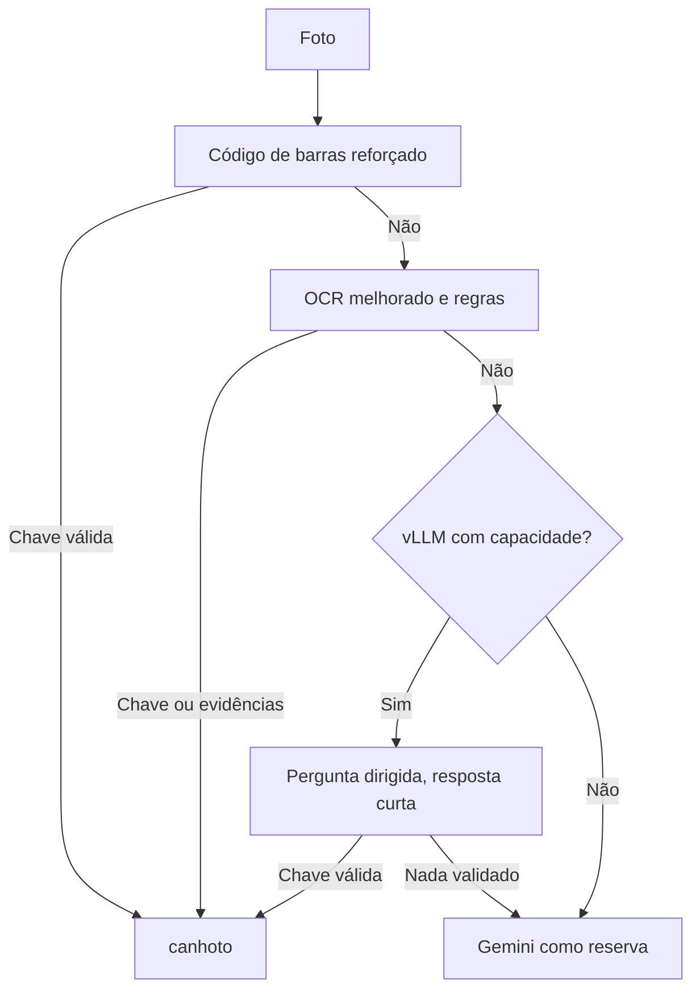

# Estudo: substituir a transcrição completa pelo vLLM — 2026-11-05

## Problema
Na foto `8GEOTHUBKA7D` o Gemini leu a chave de 44 dígitos e o serviço não leu; a transcrição pelo vLLM estourou o tempo. No gold set, a chave aparece em 63,6% das fotos com OCR e o campo do recebedor em 20%.

## Causas prováveis vistas no código
- `vision/barcode.py`: tenta só a imagem original, a orientada e metade da escala, sem pré-processamento nem recorte.
- `vision/ocr.py`: Tesseract na imagem inteira, sem pré-processamento.
- `vision/region.py`: exige as palavras exatas do rótulo; qualquer erro de OCR em "RECEBEDOR" descarta a palavra.
- O Qwen3 raciocina por padrão no vLLM, conforme a documentação, o que pode alongar cada chamada.

## Cascata proposta

## Opções, em ordem de prioridade

| # | Opção | Custo | Como medir |
|---|---|---|---|
| 1 | Código de barras reforçado: rotações, recortes, ampliação e limiarização | CPU no .160; sem modelo novo | Chaves recuperadas nas fotos sem chave do gold set |
| 2 | Rótulo do recebedor com tolerância a erro de OCR | Quase nenhum | Taxa de campo localizado, hoje 20% |
| 3 | Pergunta dirigida ao vLLM em vez de transcrição: tipo, chave, número e CNPJ, em JSON curto, validados por dígito e whitelist | Baixo por chamada; sujeito à capacidade | Tempo e chaves válidas em uma amostra |
| 4 | Desligar o raciocínio do Qwen por requisição (`chat_template_kwargs.enable_thinking=false`) | Quase nenhum; o suporte neste modelo precisa de teste | Tempo e acerto nos canhotos do gold set, com e sem |
| 5 | Pré-processar o OCR ou trocar o motor por um mais robusto | Memória no .160, limite de 2 GB | Chave e rótulo no gold set |
| 6 | Conferir número e CNPJ com dados do Bubble quando a leitura for parcial | Latência e dependência externa; acesso não verificado | Casos sem chave resolvidos com segurança |

Um modelo pequeno de visão dedicado fica para depois: soma carga ao .140 e não se paga antes de medir as opções baratas.

## O que não muda
Chave, CNPJ e número lidos por qualquer modelo só valem depois de validados por código. Isso impede que uma leitura inventada vire resposta.

Nada aqui foi implementado ou medido; os ganhos são hipóteses.
