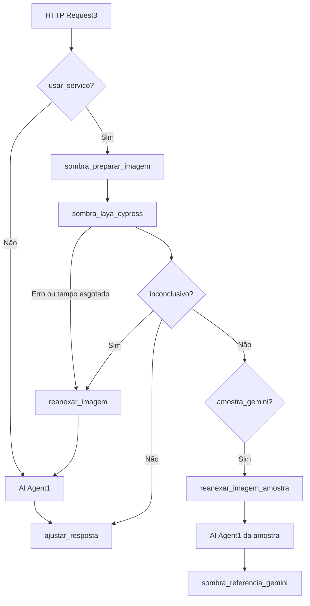

# Roteamento no n8n: serviço como fluxo principal — 2026-11-05

Decisão do usuário: o serviço (vLLM e detecção, com o Laya em sombra) é o fluxo principal, sem piloto por telefone. O Gemini é reserva quando o serviço cair ou ficar em dúvida. Duplique o fluxo antes de editar.

## Fluxo



## Nós
1. **IF `usar_servico`**, depois de `HTTP Request3`. É a chave de reversão: com `false`, todo o tráfego volta ao `AI Agent1`.
2. **`sombra_laya_cypress`:** `On Error: Continue (using error output)`, com a saída de erro ligada em `reanexar_imagem`. O tempo limite segue em 30 s; o serviço encerra as consultas em até 25 s.
3. **IF `inconclusivo`:** `{{ $json._meta.inconclusivo }}` igual a `true` vai para `reanexar_imagem`; `false` vai para `ajustar_resposta` e para `amostra_gemini`.
4. **`ajustar_resposta` não muda:** lê `$json.output`, o mesmo formato do Agent1, completa o número com zeros até 6 dígitos e descarta o `_meta`.
5. **`reanexar_imagem`:** obrigatório, porque depois do serviço o item não tem a foto e a reserva responderia sem vê-la.
   ```javascript
   return [{ json: {}, binary: $('HTTP Request3').first().binary, pairedItem: { item: 0 } }];
   ```
6. **`sombra_referencia_gemini`:** continua depois do `AI Agent1` da reserva, porque esses casos também servem de comparação.
7. **IF `amostra_gemini`:** cerca de 10% dos telefones, sempre os mesmos. Ele alimenta a comparação depois que o Gemini deixa de rodar em toda foto; a resposta do Agent1 da amostra não vai para o cliente.
   `{{ Number($('WhatsApp Trigger').item.json.contacts[0].wa_id.slice(-2)) < 10 }}`

## O que vai para a reserva
- Serviço fora do ar, com erro ou fora do tempo.
- `_meta.inconclusivo` igual a `true`: comprovante, pedido, imagem inválida, votos não unânimes, confiança do vLLM abaixo de 80, vLLM sem capacidade ou problema na auditoria (sem CNPJ, sem número, CNPJ diferente do da chave, mais de uma chave).

O serviço hoje só responde sozinho canhoto assinado com dois votos; canhoto sem assinatura sempre passa pelo Gemini.

## Antes de ligar
- Conferir a divergência de chave em `MOHPMSRQ781T`.
- Testar a reserva com foto real: serviço parado e caso inconclusivo.
- Conferir se a resposta do Agent1 corresponde à foto.
- Mover e trocar as credenciais expostas no fluxo.

## Reversão
Colocar `usar_servico` em `false`. Nada muda no serviço.
