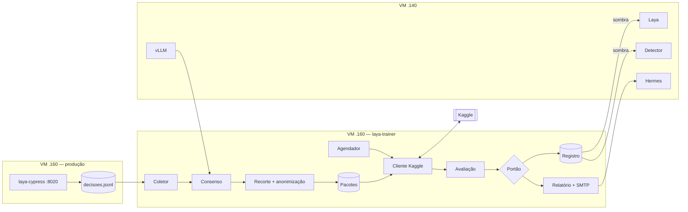

# Spec: `laya-trainer` — treino contínuo do Laya e da camada de visão — 2026-11-06

Status: rascunho para análise. Nada aqui foi implementado.
Contexto: `2026-11-05-continuidade.md`, `2026-11-05-readme-proposto.md` (features futuras) e `SPEC/spec.md`.

## 1. Objetivo
Subir um segundo container no .160 que orquestra, em ciclos offline, o treino de dois modelos no Kaggle, um por vez:
- **Laya** (texto): tipo do documento e assinatura a partir do texto do OCR e dos sinais.
- **Camada de visão** (YOLOv8 + RF-DETR, PyTorch): "a faixa do recebedor tem assinatura?".

O serviço de produção (`laya-cypress`) não muda: o vLLM segue decidindo a assinatura e as regras decidem o tipo, até os modelos novos passarem no portão e na sombra.

## 2. Decisões em vigor
| Tema | Decisão |
|---|---|
| Treino | Kaggle por API, sem aba aberta; **um job por vez**, pausa de 3 a 5 min entre eles |
| Dados que saem | Visão: só a **faixa do recebedor** (carimbo e assinatura), anonimizada. Laya: **texto do OCR anonimizado** |
| Rótulo | **Consenso** de fontes independentes do modelo treinado: vLLM, Gemini e regra do Bubble. Entra no treino só o que concorda |
| Revisão humana | Amostra pequena das **discordâncias**, prioridade para canhoto sem assinatura |
| Auditor | **vLLM**. O Hermes só redige e envia notificações |
| Fotos extras | Banco do Bubble: **candidatos**, nunca verdade |
| Carimbo | **Carimbo sozinho = não assinado.** Assinatura, com ou sem carimbo = assinado |
| Portão | Promove se o **erro no teste congelado cair 20% (relativo) ou mais** e nenhuma métrica de segurança piorar. Confiança é acompanhada, não decide |
| Licença YOLO | AGPL (checagem jurídica antes da produção) |
| E-mail | Números calculados por código; o Hermes só escreve a narrativa; cada número do texto é conferido contra o JSON |

## 3. Arquitetura


## 4. Módulos do `laya-trainer`
| Módulo | Responsabilidade |
|---|---|
| `collector` | Lê `decisoes.jsonl` (somente leitura) e as fotos candidatas do Bubble |
| `consensus` | Junta as fontes e decide o rótulo ou marca a foto como discordante |
| `cropper` | Extrai a faixa do recebedor da foto; falha em localizar vira descarte, nunca palpite |
| `anonymizer` | Remove o que identifica pessoa: texto do OCR (CPF, CNPJ, e-mail, telefone, CEP, nomes) e metadados da imagem |
| `packager` | Monta o pacote versionado com manifesto e hashes |
| `kaggle_client` | Cria o dataset privado, roda o kernel, baixa o resultado, **apaga o dataset ao fim** |
| `scheduler` | Máquina de estados do §7 |
| `evaluator` | Mede no teste congelado: modelo novo, versão atual e regras |
| `gate` | Aplica os critérios do §8 |
| `registry` | Versiona pesos por hash, guarda a versão ativa e permite rollback |
| `reporter` | Gera o JSON de métricas, pede o texto ao Hermes, valida e envia por SMTP |

Cada módulo fica com até 300 linhas e funções de até 30, conforme `docs/_rules/nio.md`.

## 5. Dados e rótulos

### 5.1 Classes da visão
`assinado`, `nao_assinado` e `carimbo_somente`. A terceira é negativa para a decisão final, mas existe como classe própria para o modelo aprender a diferença.

### 5.2 Consenso
- Fontes: vLLM, Gemini (via `/v1/referencia`) e regra do Bubble (`assinado` e existência da URL de autenticação).
- Entra no treino só a foto em que as fontes concordam. A regra do Bubble sozinha nunca rotula: `assinado = false` de outro sistema não substitui a verificação visual (`SPEC/spec.md` §4.4).
- Discordância vai para a **fila de revisão humana**. A amostra é pequena, mas a classe sem assinatura e `carimbo_somente` são revisadas por inteiro até o teste congelado ter volume.
- O vLLM rotula em lote, na janela noturna, respeitando o `judge_capacity` (nunca compete com a produção).

### 5.3 Teste congelado
- Separado uma vez, por grupo (nunca a mesma nota em treino e teste), e nunca usado para treinar.
- Rótulo do teste: consenso mais revisão humana das discordâncias.
- Só muda por decisão explícita, com nova versão do teste registrada.
- Hoje o gold set tem só 8 canhotos sem assinatura. O Bubble existe para crescer essa classe antes de o portão valer para segurança.

### 5.4 Anonimização e retenção
- Imagem: só a faixa do recebedor, sem EXIF. O nome escrito à mão dentro da faixa é dado pessoal e não é removível sem destruir o exemplo: o dataset no Kaggle é **privado**, e o `kaggle_client` o apaga ao fim de cada job.
- Texto: marcadores `[CPF]`, `[CNPJ]` etc.; nomes de pessoas por modelo local (como no ITS-FINE).
- Identificadores: o `id` da foto vira hash com chave secreta. A chave de acesso da NF-e nunca sai.
- Nada de cliente vai ao Git. Pesos ficam no registro, referenciados por hash.

## 6. Contratos
### 6.1 Manifesto do pacote (`manifest.json`)
```json
{"pacote": "visao-0007", "tipo": "visao", "criado_em": "...", "fonte_teste": "teste-v1",
 "contagens": {"assinado": 0, "nao_assinado": 0, "carimbo_somente": 0},
 "sha256": "...", "anonimizado": true}
```
### 6.2 Métricas (`metricas.json`)
```json
{"versao": "visao-0007", "base": "visao-0006", "teste": "teste-v1",
 "erro": 0.0, "erro_base": 0.0, "reducao_relativa": 0.0,
 "seguranca": {"nao_assinado_liberado": 0, "carimbo_liberado": 0},
 "confianca_media": 0.0, "por_classe": {}}
```
### 6.3 Formato de saída
O Laya treina para o formato do `Agent1` (`tipo_documento`, `assinatura`, `emitente`, `nota_fiscal`, `qrcode`), travado em `tests/test_final_output.py`. Esse contrato define a forma da resposta, não a verdade do rótulo.

## 7. Agendador
Estados: `aguardando` → `laya` → `pausa` → `visao` → `pausa` → `laya` → … → `agendado`.
- Um job por vez. Pausa configurável (`TRAINER_PAUSE_SECONDS`, padrão 240, faixa de 180 a 300).
- Só inicia um treino com **dados novos** acima de um mínimo por tipo (`TRAINER_MIN_NEW_*`). Sem isso, fica em `aguardando`.
- A cota do Kaggle é **semanal**; o erro de cota leva a `agendado` para a próxima janela. Cada rodada tem limite de ~9 h. Os valores devem ser conferidos na conta.
- Estado persistido em `/srv/trainer/estado.json`; sobrevive a reinício. Falha de job não apaga o pacote e repete com recuo, no máximo `TRAINER_MAX_RETRIES`.
- Recorte, rotulagem e envio só rodam na janela noturna (`TRAINER_WINDOW`).

## 8. Portão
A versão nova é promovida **para a sombra** quando, no teste congelado:
1. o erro cai **20% (relativo) ou mais** frente à versão atual; e
2. nenhuma métrica de segurança piora: **zero** canhoto sem assinatura liberado e **zero** `carimbo_somente` liberado; e
3. não perde para as regras.

Ficar em sombra não muda a resposta de produção. A saída da sombra para decisora exige um critério à parte (proposta: N semanas em tráfego real, com zero liberação indevida e concordância com o vLLM acima de um valor a definir). "100%" não é meta.
A confiança é registrada em todo ciclo, mas **não** é critério de promoção.

## 9. Relatório por e-mail
- **Gatilho:** o portão passou. Um e-mail por versão promovida (idempotente pelo identificador da versão).
- **Conteúdo:** antes e depois do modelo, o que era gap, onde melhorou, o que falta, o que está em andamento.
- **Geração:** o `reporter` calcula os números e monta o JSON. O Hermes recebe só esse JSON e escreve o texto. Um validador confere que cada número do texto existe no JSON; se não existir, o e-mail não sai e o erro fica no log.
- **Segurança:** SMTP por variáveis de ambiente do stack (`SMTP_HOST`, `SMTP_PORT`, `SMTP_USER`, `SMTP_PASSWORD`, `SMTP_FROM`, `REPORT_TO`). Sem imagem, chave de acesso nem dado de cliente no corpo.

## 10. Deploy
Compose próprio no mesmo repositório, com Portainer, na rede `laya_default`, sem portas publicadas.
```yaml
  laya-trainer:
    build: ./trainer
    container_name: laya-trainer
    restart: unless-stopped
    cpus: "1.0"
    cpu_shares: 256
    mem_limit: 1g
    pids_limit: 128
    read_only: true
    tmpfs: ["/tmp:size=256m"]
    security_opt: ["no-new-privileges:true"]
    volumes:
      - /opt/laya-cypress/dados:/srv/dados:ro
      - /opt/laya-trainer/data:/srv/trainer
```
- Sem Tesseract nem PyTorch na imagem.
- Credenciais do Kaggle e do SMTP só em variável de ambiente do stack ou arquivo montado com permissão 600.

## 11. Pré-requisitos e perguntas abertas
1. **Onde o ITS-FINE roda.** Ele vive no projeto no Windows e é conduzido pelo agente (skills), não por um serviço. O `laya-trainer`, no .160, não o executa. Decidir: o container chama os scripts dos motores (`hf-encoder`) diretamente, ou o ciclo do Laya continua conduzido pelo ITS-FINE.
2. **Motor de visão.** O ITS-FINE instalado tem `hf-peft`, `hf-encoder` e `hf-tts`, sem detecção nem classificação de imagem. O treino da visão usa script próprio no kernel do Kaggle (`rfdetr` e `ultralytics`).
3. **Permissões.** `allow_kaggle` está `false` em `.its-fine/policy.json` e `transfer_destinations` está vazio. Só o usuário muda isso, por `python .its-fine/bin/fine.py permissoes`.
4. **Conta Kaggle** com telefone verificado e o token do `kaggle`. O valor da cota de GPU precisa ser conferido.
5. **Volume mínimo** de dados novos por ciclo e tamanho da amostra de revisão humana.
6. **LGPD:** base legal para treino com foto de cliente e prazo de retenção do pacote.
7. **AGPL do YOLOv8:** parecer jurídico antes da produção.
8. **A faixa do recebedor** depende de um localizador; o campo é achado em só 20% das fotos pelo OCR. O `cropper` precisa de uma estratégia melhor que o rótulo do OCR (por exemplo, a faixa superior da página após a rotação correta).

## 12. Fatias de entrega
1. **Esqueleto do container:** compose, limites, estado persistido, healthcheck. Sem treino.
2. **Coletor e consenso** sobre `decisoes.jsonl` e `referencia`, com a fila de discordâncias.
3. **Recorte e anonimização**, com pacote versionado e manifesto.
4. **Cliente Kaggle:** criar dataset privado, rodar um kernel de teste, baixar e apagar.
5. **Treino da visão** (RF-DETR, depois YOLOv8) e avaliação no teste congelado.
6. **Treino do Laya** com texto anonimizado.
7. **Agendador completo** (alternância, pausa, cota, janela noturna).
8. **Portão e registro** de versões, com rollback.
9. **Relatório por e-mail** com o validador de números.
10. **Sombra em produção:** servir a versão nova em paralelo e medir contra o vLLM.

## 13. Fora do escopo
- Treino na VM de produção.
- Mudar a decisão atual de produção (vLLM para assinatura, regras para tipo).
- Rotulagem humana em volume. Só a amostra das discordâncias.
