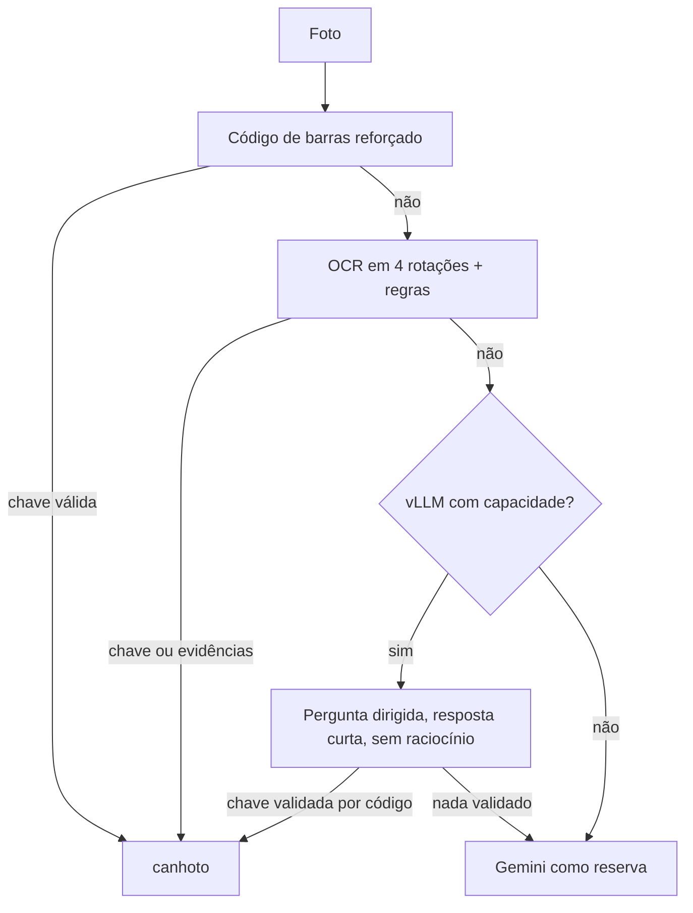

# Spec F5: leitura do documento (chave, OCR e juiz) — 2026-11-06

Status: parte implementada atrás de flag, o resto aguarda medição.
Base: `2026-11-05-estudo-substituicao-transcricao.md` (opções 1 a 6) e os casos reais de 06/11.

## 1. Problema
O serviço devolve `imagem_invalida`, `pedido` ou "sem assinatura" em fotos que o Gemini lê como canhoto. Em todos os casos vistos a causa é a **leitura**, não a decisão.

| Caso (nota) | O que falhou | Estado |
|---|---|---|
| 817663 | OSD do Tesseract escolheu 180°, OCR vazio, sem chave | **Corrigido:** `ocr.run` testa as 4 rotações quando o texto vem curto (`MIN_READABLE_CHARS`) |
| 817937 | Foto amassada: OCR de 592 caracteres, só 1 palavra de NF-e, sem chave; itens de cabeçalho viraram `pedido` | **Mitigado:** uma palavra de NF-e bloqueia `pedido` em `rules.classify`. A chave segue sem leitura |
| 413886 | Juiz de assinatura falhou, latência de 23,6 s (tempo ou JSON truncado) | **Instrumentado:** `erros` no registro de decisões. Causa raiz depende do log |
| 607345 | Juiz contou carimbo como assinatura | **Corrigido:** prompt do juiz |

## 2. Cascata alvo

Regra que não muda: chave, CNPJ e número lidos por qualquer modelo só valem depois de validados por código (dígito verificador e whitelist).

## 3. Opções e estado
| # | Opção | Estado | Como medir / critério |
|---|---|---|---|
| 1 | Código de barras reforçado | Implementado (rotações, recortes, ampliação, limiar). Foto curva de 06/11 ainda não lê | Chaves recuperadas nas fotos sem chave do gold set; avaliar mais inclinações e o recorte do quadrante da chave |
| 2 | Rótulo do recebedor tolerante a erro de OCR | **Não implementado, de propósito** | Hoje campo não localizado vira `UNCERTAIN`; tolerar o rótulo manda mais fotos às regras de tinta e pode liberar ou barrar assinatura. Só entra com `medir_leitura_gold.py` mostrando zero liberação indevida |
| 3 | Pergunta dirigida ao vLLM (`JUDGE_READ_KEY`) | Implementado, desligado | Ligar só se `medir_chave_vllm.py` der `com_codigo.valida_diferente` igual a 0 |
| 4 | Desligar o raciocínio do Qwen por requisição | **Implementado, desligado** (`JUDGE_DISABLE_THINKING=1`) | `medir_pensamento_juiz.py`: respostas, mediana, p95 e concordância com e sem raciocínio |
| 5 | Pré-processar o OCR ou trocar o motor | Não iniciado | Chave e rótulo no gold set; limite de 2 GB do container |
| 6 | Conferir número e CNPJ com o Bubble | Não iniciado | Acesso não verificado |

## 4. O que a opção 4 muda
- Envia `chat_template_kwargs: {"enable_thinking": false}` no corpo de `/v1/chat/completions`.
- Com a flag ligada, as perguntas de assinatura e chave usam `max_tokens = 256` (a resposta é um JSON curto). A transcrição continua com 2048.
- Com a flag desligada nada muda: o corpo da requisição é o mesmo de antes.
- Hipótese a testar: o raciocínio consome o orçamento de tokens e o tempo, e explica parte das falhas e dos 20 a 23 s do juiz. Sem medição, é só hipótese.

### Como ligar com segurança
1. Copie 20 a 40 fotos de teste para `/opt/laya-cypress/dados/amostra` (dono 10002).
2. Rode `docker exec -i laya-cypress python - /srv/dados/amostra < medir_pensamento_juiz.py`.
3. Critério para ligar: respostas sem raciocínio >= com raciocínio, p95 claramente menor e a opinião igual na grande maioria. Se a opinião mudar em casos que importam, não ligue.
4. No `compose.yaml`, acrescente `JUDGE_DISABLE_THINKING: ${JUDGE_DISABLE_THINKING:-}` ao `environment` e defina `1` no stack. Apague `amostra` depois.

## 5. Riscos e limites
- O vLLM pode ignorar `chat_template_kwargs` (depende da versão e do modelo): nesse caso a flag não tem efeito, e o teste mostra isso.
- Fotos de cliente na `amostra`: apagar ao fim; o script imprime só agregados.
- Reparar um dígito de chave lido errado pelo OCR **não** está no escopo: a spec original proíbe estimar dígitos, e a chave errada anexa a nota errada.

## 6. Pendências
- Rodar a medição da opção 4 e decidir a flag.
- Investigar a foto curva de 06/11 na opção 1 (mais inclinações, recorte do quadrante da chave).
- F4: executar `medir_chave_vllm.py` para decidir `JUDGE_READ_KEY`.
- Medir a opção 2 no gold set antes de qualquer mudança em `region.py`.
